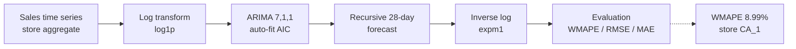
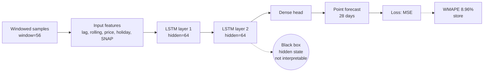
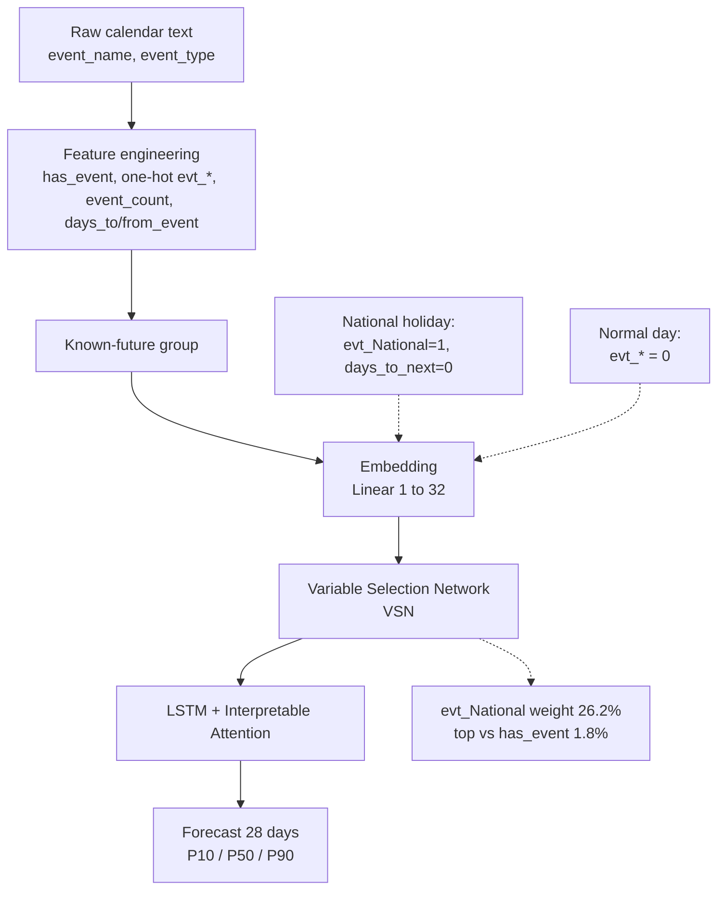

# PROMPT VẼ SƠ ĐỒ KHỐI (ARIMA / LSTM / HOLIDAY)

Phong cách chung: clean academic block diagram, white background, flat design,
rounded rectangle boxes, solid arrows with arrowheads, textbook/paper style,
màu pastel (xanh dương nhạt cho input, vàng cho xử lý, xanh lá cho output/diễn giải).
Dùng tiếng Anh để AI tạo ảnh hiểu tốt nhất.

====================================================================
1) ARIMA  (giống reports/figures/diagram_arima.png)
====================================================================
Prompt (AI image):
"Clean academic block diagram, white background, flat design. Rounded rectangle
boxes with soft blue (#DCE6F1) fill and dark blue borders, black arrows with
arrowheads flowing left to right. Title at top: 'ARIMA Baseline Model'.
Boxes in order: (1) 'Sales time series (store aggregate)'; (2) 'Log transform
log1p'; (3) 'ARIMA(7,1,1) auto-fit (AIC)'; (4) 'Recursive 28-day forecast';
(5) 'Inverse log expm1'; (6) 'Evaluation: WMAPE / RMSE / MAE'.
Bottom note: 'WMAPE 8.99% (store CA_1)'. Minimal, textbook style, no photorealism."

Mermaid (alternative, render tại mermaid.live):

====================================================================
2) LSTM  (giống reports/figures/diagram_lstm.png)
====================================================================
Prompt (AI image):
"Clean academic block diagram, white background, flat design. Rounded rectangle
boxes, arrows left-to-right then down. Title: 'LSTM Baseline Model'. Boxes:
(1) 'Windowed samples (window=56)'; (2) 'Input features: sales lag, rolling,
price, holiday, SNAP'; (3) 'LSTM layer 1 (hidden=64)'; (4) 'LSTM layer 2
(hidden=64)'; (5) 'Dense head'; (6) 'Point forecast (28 days)'; (7) 'Loss: MSE'.
Right side dashed red box: 'Black box: hidden state not interpretable'.
Bottom note: 'WMAPE 8.96% (store)'. Soft green/blue palette, textbook style."

Mermaid:

====================================================================
3) HOLIDAY REPRESENTATION  (giống reports/figures/diagram_holiday.png)
====================================================================
Prompt (AI image):
"Clean academic block diagram, white background, flat design. Rounded boxes with
arrows, flow top to bottom zig-zag. Title: 'Holiday Representation in Transformer'.
Boxes: (1) 'Raw calendar text: event_name, event_type'; (2) 'Feature engineering:
has_event, one-hot evt_National / evt_Sporting / evt_Cultural / evt_Religious,
event_count, days_to_next_event, days_since_last_event'; (3) 'Known-future group';
(4) 'Embedding Linear(1 -> 32)'; (5) 'Variable Selection Network (VSN)';
(6) 'LSTM + Interpretable Attention'; (7) 'Forecast 28 days (P10/P50/P90)'.
Right small box example: 'National holiday: evt_National=1, days_to_next=0'
vs 'Normal day: evt_*=0'. Bottom note: 'evt_National weight 26.2% (top)
vs has_event 1.8%'. Color code: orange raw, yellow engineering, blue model,
green interpretable. Textbook style."

Mermaid:

====================================================================
LƯU Ý KHI DÙNG AI TẠO ẢNH
====================================================================
- Thêm cụm "minimal, no text clutter, high contrast labels" nếu chữ bị lộn xộn.
- Nếu muốn tiếng Việt trên ảnh, thay nhãn trong prompt thành tiếng Việt nhưng
  rủi ro lỗi font; khuyên dùng tiếng Anh rồi tự chèn chú thích trong báo cáo.
- 3 ảnh này đã có sẵn (matplotlib) tại reports/figures/diagram_*.png — chỉ dùng
  prompt trên nếu muốn làm lại đẹp hơn bằng công cụ ngoài.
